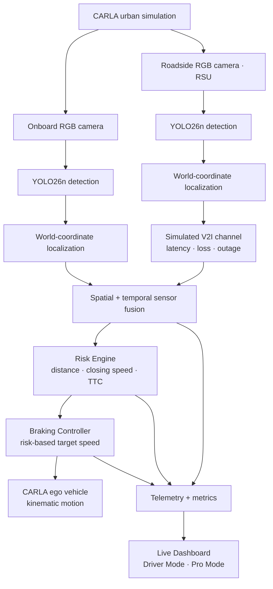
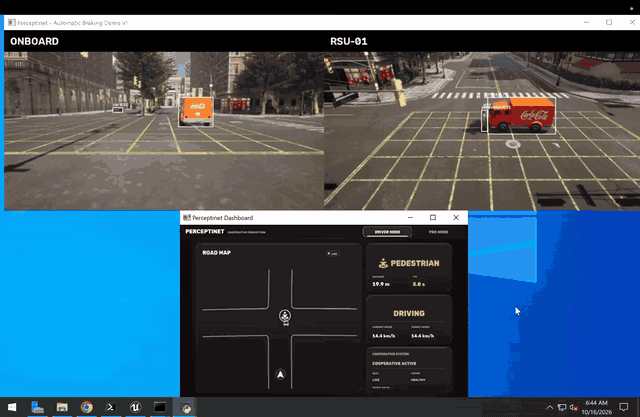
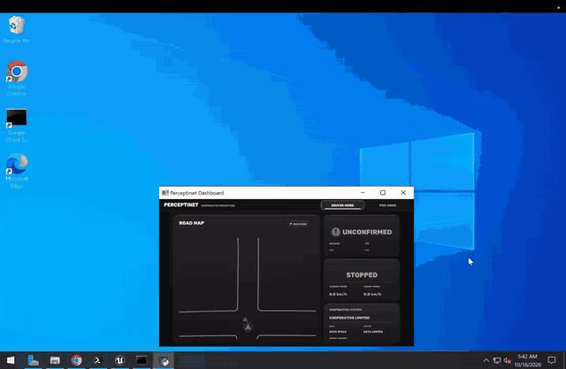

<div align="center">

# Perceptinet

### Cooperative Perception & Risk-Aware Braking in CARLA

**See beyond a single vehicle's field of view.**

A Python-based autonomous-driving research prototype that combines onboard and roadside perception, simulated vehicle-to-infrastructure (V2I) communication, spatial sensor fusion, time-to-collision risk assessment, and automated braking in a reproducible CARLA environment.

[](https://www.python.org/)
[](https://carla.org/)
[](https://docs.ultralytics.com/)
[](https://opencv.org/)


[Architecture](#system-architecture) · [Demos](#demo-showcase) · [Scenarios](#comparative-scenarios) · [Quick Start](#quick-start) · [Results](#evaluation--reporting) · [Limitations](#scope--limitations)

</div>

---

## Overview

An ego vehicle can miss a road user hidden by an occluding truck or other traffic. Perceptinet explores how an elevated roadside unit (**RSU**) can provide a complementary view, transmit observations over a simulated **V2I** link, and support earlier risk assessment.

The project models the complete **perception → communication → fusion → risk → control** workflow, rather than stopping at object-detection overlays.

### Key capabilities

- **Multi-class, dual-camera perception** — YOLO26n inference on onboard and RSU RGB feeds, targeting pedestrians, bicycles, cars, motorcycles, buses, and trucks.
- **Simulation-assisted spatial localization** — CARLA camera geometry, projected actor matching, and world-coordinate observations.
- **Cooperative sensor fusion** — spatial association, temporal tracks, and short-term dropout handling across the two viewpoints.
- **Configurable V2I fault injection** — timestamped packets, simulation-time delivery queues, latency/jitter, packet loss, stale-data rejection, and temporary blackouts.
- **Risk-aware speed control** — path-relative distance, closing speed, time-to-collision (**TTC**), hazard levels, and a deterministic braking controller.
- **Live observability** — interactive **Driver Mode / Pro Mode** dashboards, per-cycle telemetry, JSON/CSV exports, and comparative reports.

## System architecture



| Layer | Implementation |
| --- | --- |
| **Simulation** | CARLA Python API, RGB sensors, urban roads/intersections, controllable weather and actors |
| **Perception** | Python, Ultralytics YOLO26n, OpenCV, NumPy |
| **Localization & fusion** | Camera projection, CARLA actor association, spatial matching, lightweight temporal tracking |
| **Communication** | Python V2I packet model; simulation-time queue for impaired delivery |
| **Decision & control** | TTC-based Risk Engine and deterministic braking controller |
| **Observability** | OpenCV-based Driver/Pro dashboards; JSON, CSV and optional PDF reporting |

## Demo showcase

Two short recordings from the CARLA experiments show the **same occluded pedestrian crossing** under different communication conditions. Each recording includes the onboard and RSU feeds plus the live dashboard.

| Scenario 1 — normal V2I | Scenario 2 — degraded V2I |
| :---: | :---: |
| [](assets/scenario-1.mp4) | [](assets/scenario-2.mp4) |
| Clear-weather RSU warning, braking and controller STOPPED state | Heavy rain, injected communication blackout and observed **kinematic footprint contact** |
| [Watch the full recording (MP4)](assets/scenario-1.mp4) | [Watch the full recording (MP4)](assets/scenario-2.mp4) |

> **Recorded evidence:** These clips show the demo output, not a production vehicle test. The `CONTACT (SIM)` indicator in Scenario 2 denotes geometric overlap in the kinematic simulation—not a verified physics-based collision. GitHub displays the animated GIF previews after the four media assets are uploaded to `assets/`.

## Comparative scenarios

Two controlled intersection/occlusion experiments share the **same pedestrian crossing configuration, perception model, scene geometry, and control logic**. The treatment changes the weather visualization and V2I reliability.

| | **Scenario 1 · Cooperative baseline** | **Scenario 2 · Communication stress test** |
| --- | --- | --- |
| Weather | Clear | Heavy rain / reduced visibility |
| RSU → ego latency | 25 ± 5 ms simulated metadata | 1,200 ± 200 ms queued simulation-time delivery |
| Random packet loss | 0% | 30% (seeded) |
| Signal blackout | None | 3 s after first RSU pedestrian detection |
| Pedestrian movement | CARLA WalkerControl crossing | Same crossing parameters |
| Objective | Evaluate early warning and stopping | Observe late/missing information and braking consequences |

**What happens?** A pedestrian emerges from behind an occluding vehicle. The RSU can provide a different view from the onboard camera. Perceptinet fuses available observations and computes a TTC-based risk state; the ego controller responds to the resulting warning level.

The crossing begins when the pedestrian is about **11.5 m** longitudinally ahead of the ego vehicle, at a commanded **0.95 m/s** walking speed. Scenario outcomes are **measured**, not hard-coded: the degraded-link case is not guaranteed to collide, and the baseline is not automatically marked safe.

> **Experimental integrity:** CARLA rain changes the simulated scene's appearance. The communication degradation is **injected separately in Python**; the project does not claim that CARLA weather physically creates RF interference. The baseline V2I model annotates latency, while Scenario 2 uses a queue that withholds packets until their simulated delivery time.

See [Scenario comparison and experimental notes](SCENARIO_2_COMPARISON_GUIDE.md).

## Quick start

### Prerequisites

- **Windows** desktop session, **Python 3.12**, and a running/launchable **CARLA 0.9.16** installation.
- Python dependencies from [`requirements.txt`](requirements.txt). Use a CARLA Python package/wheel compatible with your local simulator and Python environment.
- **YOLO26n** model weights accessible to Ultralytics. The teacher-demo script looks for `C:\CARLA\yolo26n.pt` and otherwise attempts to load `yolo26n.pt` by name.
- A graphics-capable machine for CARLA and inference. The current teacher-demo configuration uses **YOLO device `0`** (typically the first CUDA GPU); adjust `YOLO_DEVICE` in [the demo script](scripts/run_occluded_pedestrian_braking_v1.py) for your setup.
- CARLA RPC reachable at `127.0.0.1:2000`. The launcher checks the **actual CARLA world/map RPC**, not just whether the port is open.

```powershell
git clone https://github.com/vinceyuchen/Perceptinet.git
cd Perceptinet
py -3.12 -m pip install -r requirements.txt

# Verify launcher paths and selected scenario without starting CARLA
py -3.12 .\Perceptinet_Teacher_Demo.py --dry-run
```

Start CARLA before the demo, or provide its executable with `--carla-exe` / the `PERCEPTINET_CARLA_EXE` environment variable. The launcher also checks common Windows CARLA installation paths.

### Run a demo

| Mode | Windows launcher |
| --- | --- |
| **Scenario 1** · clear-weather baseline (loops) | `START_TEACHER_DEMO.bat` |
| **Scenario 2** · rain + injected V2I faults (loops) | `START_RAIN_SCENARIO_DEMO.bat` |
| **Alternating comparison** · clear → rain → repeat | `START_COMPARISON_DEMO.bat` |

Double-click a launcher, or run one cycle from PowerShell:

```powershell
py -3.12 .\Perceptinet_Teacher_Demo.py --scenario clear --cycles 1
py -3.12 .\Perceptinet_Teacher_Demo.py --scenario rain_v2i --cycles 1
py -3.12 .\Perceptinet_Teacher_Demo.py --scenario alternate --cycles 2
```

The live demo opens the **CARLA spectator view**, **onboard/RSU detection feeds**, and the **Perceptinet Dashboard**. Switch dashboard views with the **Driver / Pro** buttons (or `D` / `P`); press `Q` in the camera window or launcher console, or close the dashboard, to stop. The launcher requests scene cleanup.

## Evaluation & reporting

Each completed teacher-demo cycle writes separate artifacts under `results/teacher_demo/runs/cycle_*/`, including:

- `scenario_result.json` — completion reason, braking/detection timestamps, walker motion, closest centre-to-centre separation, and observed contact indicators.
- `metrics_summary.json` and `metrics_events.csv` — latency summaries, detection timing, braking events, and other diagnostic metrics.
- `occluded_pedestrian_world_v1.csv` — matched detection and world-coordinate observations.

To generate a comparison report **from your own recorded runs**:

```powershell
py -3.12 -m pip install reportlab
py -3.12 .\scripts\generate_teacher_demo_report.py
```

Reports are written to `results/teacher_demo/report/` as **PDF, CSV, and JSON**. Missing run data are left pending rather than replaced with fabricated measurements. Runtime artifacts are ignored by Git.

### Focused regression tests

```powershell
py -3.12 .\scripts\test_risk_engine.py
py -3.12 .\scripts\test_braking_controller.py
py -3.12 .\scripts\test_v2i_channel.py
py -3.12 .\scripts\test_teacher_pedestrian_crossing.py
py -3.12 .\scripts\test_teacher_demo_report.py
```

These cover selected Python components; they do **not** replace a full live CARLA validation run.

## Repository structure

```text
Perceptinet/
├── perception/                 # YOLO26n inference and world-coordinate projection
├── v2i/                        # V2I metadata and impaired packet delivery
├── fusion/                     # Spatial association and temporal fusion
├── risk/                       # Path-relative and TTC risk assessment
├── control/                    # Deterministic braking controller
├── simulation/                 # CARLA scene, road context and walker logic
├── dashboard/                  # Driver Mode and Pro Mode UI
├── metrics/                    # Latency, detection and braking measurements
├── validation/                 # Evaluation and validation helpers
├── scripts/                    # Experiments, tests and report generation
├── Perceptinet_Teacher_Demo.py  # Live demo orchestrator
└── START_*_DEMO.bat             # Windows one-click launchers
```

## Scope & limitations

Perceptinet is a **simulation research prototype**, not a production autonomous-driving or safety-certified system.

- In the current teacher demo, **ego motion is kinematic** (CARLA vehicle physics disabled); braking is represented by commanded speed and transforms, not a physically validated vehicle dynamics model.
- Spatial association can use **CARLA actor identity and simulator geometry**. This is simulation-assisted localization, not an independently validated real-world 3D detection system.
- A `kinematic_contact` event means **2D actor footprint overlap**, not a proven physics-simulated crash. CARLA collision-sensor events are recorded separately when available.
- Weather and V2I impairments are separately configured; the radio model is **not a calibrated wireless or meteorological propagation model**.
- Demo parameters, TTC thresholds, and deceleration rates are for **controlled evaluation**, not certified road-safety performance.

### Next steps

Improve degraded-link resilience (adaptive freshness checks, fallback strategies, and fault-aware fusion), extend multi-road-user evaluation, and validate braking/contact behavior with a physics-enabled ego model.

---

<div align="center">

**Perceptinet** · Built for research in cooperative perception, connected vehicles, and autonomous-driving safety.

Developed by [Vince](https://github.com/vinceyuchen) · [Source code](https://github.com/vinceyuchen/Perceptinet)

</div>
